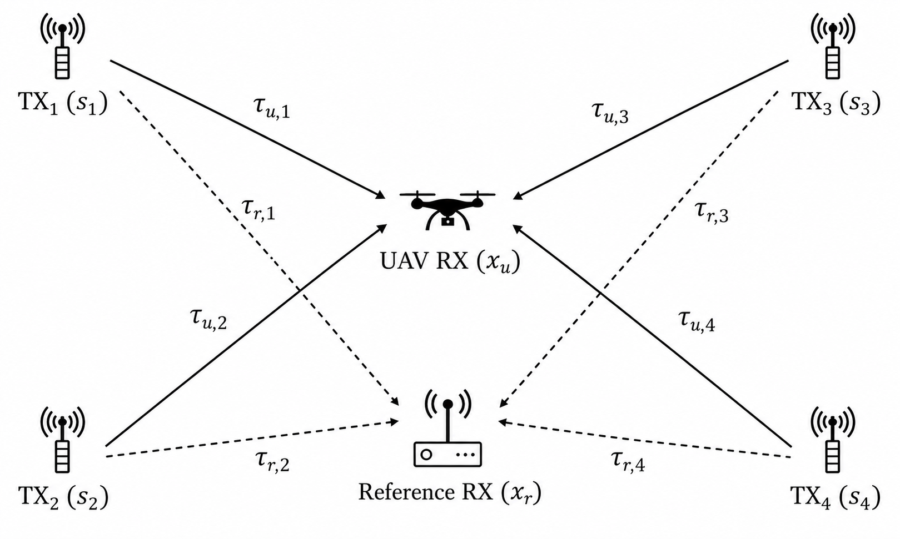
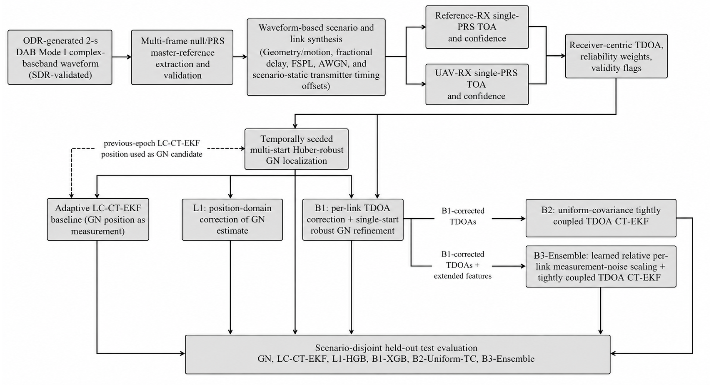
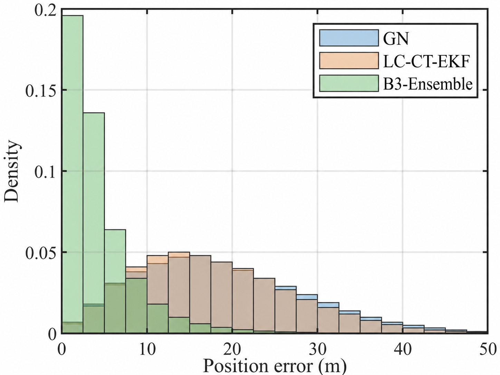
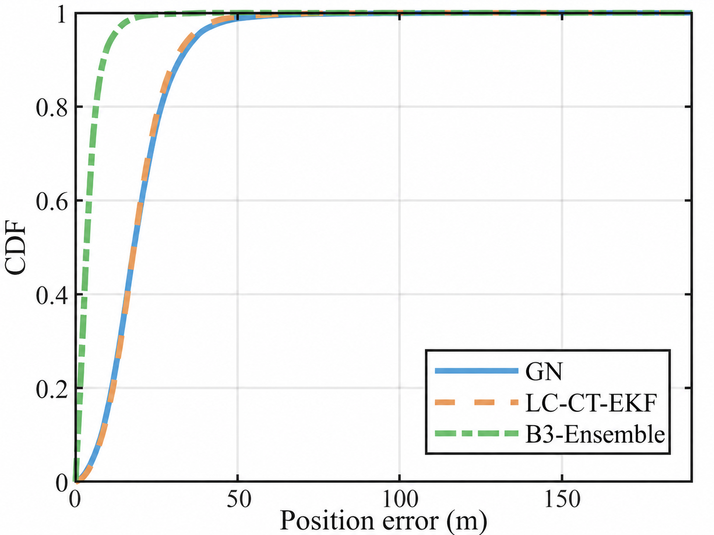

# Learning-Assisted Receiver-Centric TDOA Localization Using DAB Signals of Opportunity

Code, dataset and results of the paper

> M. F. Beker, A. Tan, K. Elgammal and M. K. Özdemir,
> **"Learning-Assisted Receiver-Centric TDOA Localization Using DAB Signals of Opportunity,"**
> submitted to *IEEE Access*.

A UAV is localized from time differences of arrival (TDOA) of Digital Audio
Broadcasting (DAB) signals of opportunity. A static reference receiver (REF)
and the UAV receive the same four DAB transmitters; subtracting the REF TOA
from the UAV TOA cancels the common transmitter timing offset
(receiver-centric TDOA). Learning-assisted corrections are then applied in the
position domain (L1), in the measurement domain (B1), and in a tightly coupled
TDOA CT-EKF with learned per-link measurement noise scales (B3).

<p align="center">
  
</p>

On the scenario-disjoint test set, B3-Ensemble reduces the mean localization
error from **16.39 m** (GN) to **3.95 m** and the 95th-percentile error from
**32.93 m** to **11.83 m**.

## Contents

| Folder | Content |
|---|---|
| [`matlab/`](matlab/) | Waveform-based simulator that generates the dataset: DAB link synthesis, PRS-based TOA estimation, multi-start weighted GN, adaptive LC-CT-EKF |
| [`python/`](python/) | Learning-assisted pipeline: L1, B1, B2, B3, evaluation, bootstrap, figures |
| [`dab_generation/`](dab_generation/README.md) | ODR-based DAB waveform generation and ADALM-PLUTO transmission GUI |
| [`data/dab_iq/`](data/dab_iq/) | DAB Mode-I baseband waveform used by the simulator (Git LFS) |
| [`dataset_results/`](dataset_results/README.md) | The dataset of the paper (10,000 scenarios, 500,000 epochs) |
| [`ai_results/`](ai_results/README.md) | Test-set results of the paper (Tables 5 and 6, bootstrap CIs) |
| [`figures/`](figures/) | Figures 1–7 of the paper |
| [`media/`](media/) | Photos and video of the over-the-air test |

<p align="center">
  
</p>

The MATLAB simulator covers the chain up to GN and LC-CT-EKF and writes the
dataset; the Python pipeline implements L1, B1, B2, B3 and the evaluation.

## Repository structure

```
.
├── matlab/
│   ├── generate_dab_tdoa_dataset.m   Main script (all settings at the top)
│   └── functions/
│       ├── signal/        IQ loading, DAB Null/PRS detection, channel, TOA estimation
│       ├── geometry/      Random TX/REF layout, GDOP, geometry score
│       ├── trajectory/    UAV paths (circle, line, sine, sine2)
│       ├── localization/  TDOA weights, multi-start weighted GN, reliability check
│       ├── tracking/      Maneuver-adaptive LC-CT-EKF
│       ├── simulation/    One scenario / one link of the simulation
│       ├── dataset/       Output columns, observation quality, train/val/test split
│       ├── evaluation/    GN vs LC-CT-EKF tables, diagnostic figures
│       └── utils/
├── python/
│   ├── run_ai_pipeline.py            Trains and evaluates L1 / B1 / B2 / B3
│   ├── make_paper_figures.py         GN vs LC-CT-EKF vs B3-Ensemble figures
│   ├── requirements.txt
│   └── dab_tdoa/
│       ├── config.py      Settings (paths, seeds, model families, EKF grids)
│       ├── data.py        Loading (CSV or CSV parts) and scenario-wise split
│       ├── features.py    Leakage-free features and targets
│       ├── models.py      XGBoost / ExtraTrees / HistGradientBoosting
│       ├── gn.py          Weighted robust GN solver
│       ├── ekf.py         Tightly coupled TDOA CT-EKF
│       ├── levels.py      L1, B1, B2, B3
│       ├── analysis.py    Tables, per-group analysis, bootstrap, plots
│       └── utils.py       Metrics and helpers
├── dab_generation/                   DAB waveform generation and TX GUI
├── data/dab_iq/
│   ├── basic.cf32                    DAB Mode-I baseband IQ waveform (Git LFS)
│   └── basic.json                    Waveform metadata
├── dataset_results/
│   ├── dab_soop_tdoa_ctekf/          Full per-epoch table, 10 gzip parts
│   ├── dab_soop_tdoa_ai_ready_gn_correction/   AI-ready table, 10 gzip parts
│   ├── dab_soop_tdoa_summary.csv     One row per scenario
│   ├── tables/                       GN vs LC-CT-EKF over the full dataset
│   ├── figures/                      Diagnostic figures (PNG + MATLAB .fig)
│   └── SHA256SUMS
├── ai_results/
│   ├── summary_table.csv             Overall test metrics (Table 5)
│   ├── detailed_analysis.csv         Per motion / geometry / quality class (Table 6)
│   └── scenario_bootstrap_ci.csv     Scenario-level bootstrap 95% CIs
├── figures/                          Paper figures
├── media/                            Over-the-air test
└── results/                          Created by the code (not tracked)
```

## Requirements

**MATLAB** – base MATLAB. The Parallel Computing Toolbox is optional; without
it the scenario loop runs serially and gives identical results.

**Python** 3.9 or newer:

```bash
cd python
pip install -r requirements.txt
```

**Git LFS** – `data/dab_iq/basic.cf32` (98 MB) and the test video are stored
with Git LFS:

```bash
git lfs install
git clone https://github.com/Furkanbeker/learning-assisted-dab-tdoa.git
```

If `basic.cf32` is only a small text pointer after cloning, run `git lfs pull`.

## Quick start

**Reproduce the paper results from the included dataset**

```bash
cd python
python run_ai_pipeline.py       # reads ../dataset_results/dab_soop_tdoa_ai_ready_gn_correction/
python make_paper_figures.py
```

Outputs are written to `results/ai_results/`: `summary_table.csv`,
`detailed_analysis.csv`, `scenario_bootstrap_ci.csv`, `final_summary.json`,
`feature_list.csv`, the test-set position estimates
(`l1/b1/b2_uniform_tc/b3_pred_test.npy`), diagnostic plots and
`paper_figures/`. Use `--data` to select another dataset (a CSV file or a
folder of CSV parts) and `--out` to change the output folder. The full run
takes several hours or more, mainly because of the B2/B3 CT-EKF grid
searches on the 75,000 validation epochs.

**Generate a new dataset (MATLAB)**

Run `matlab/generate_dab_tdoa_dataset.m`. For a quick test set
`numScenarios = 20` in the USER SETTINGS section. The outputs are written to
`results/dab_soop_tdoa_dataset_<timestamp>/`:

| File | Content |
|---|---|
| `dab_soop_tdoa_ctekf.csv` | Full per-epoch table |
| `dab_soop_tdoa_summary.csv` | One row per scenario |
| `dab_soop_tdoa_ai_ready_gn_correction.csv` | AI-ready table with the `split` column |
| `dab_soop_tdoa_gn_ctekf.mat` | Full and summary tables, simulation settings |
| `dab_soop_tdoa_ai_ready_gn_correction.mat` | AI-ready table, feature/target names, split scenario IDs |
| `gn_ctekf_overall.csv`, `gn_ctekf_by_motion.csv` | GN vs LC-CT-EKF error statistics |
| `figures/` | Diagnostic figures |

Then run the Python pipeline on it:

```bash
python run_ai_pipeline.py --data ../results/dab_soop_tdoa_dataset_<timestamp>/dab_soop_tdoa_ai_ready_gn_correction.csv
```

## Dataset

The dataset in [`dataset_results/`](dataset_results/README.md) contains the
full table (149 columns), the AI-ready table with the train/val/test `split`
(110 columns) and the per-scenario summary. GitHub does not accept files
larger than 100 MB, so the two large tables (1.16 GB and 820 MB as CSV) are
stored as ten gzip-compressed parts each. Every part holds 1,000 complete
scenarios with its own header row, and the parts reassemble byte for byte
into the original CSV files (SHA-256 checksums are provided).

```python
import glob
import pandas as pd

files = sorted(glob.glob("dataset_results/dab_soop_tdoa_ai_ready_gn_correction/*.csv.gz"))
df = pd.concat((pd.read_csv(f) for f in files), ignore_index=True)   # 500,000 x 110
```

Reassembly commands and the column overview are given in
[`dataset_results/README.md`](dataset_results/README.md).

## Methods

| Method | Description |
|---|---|
| GN | Temporally seeded multi-start weighted robust Gauss-Newton on the receiver-centric TDOAs |
| LC-CT-EKF | Maneuver-adaptive loosely coupled coordinated-turn EKF on the GN fixes |
| L1 | Regression of the GN position error, added to the GN estimate |
| B1 | Regression of the per-link TDOA error; corrected TDOAs are re-solved with weighted GN |
| B2 | B1 + tightly coupled TDOA CT-EKF with a uniform, validation-tuned measurement covariance |
| B3 | B1 + tightly coupled TDOA CT-EKF with per-link measurement noise scales predicted by the arithmetic mean of XGBoost, ExtraTrees and HistGradientBoosting |

- L1 and B1 train XGBoost, ExtraTrees and HistGradientBoosting (L1 also an
  inverse-MAE ensemble) and select the family with the validation objective
  J = mean + 0.10·P90 + 0.10·P95 + 0.05·P99. The executed run selects HGB for
  L1 and XGB for B1.
- B3 targets are built from five-fold scenario-grouped out-of-fold B1-XGB
  predictions with fold-local scaling.
- The process and measurement covariance scales of B2 and B3 are searched on
  the validation set (α_Q ∈ {0.01 … 1000}, α_R ∈ {0.10 … 20}); the NIS gate
  is 13.28 (χ², 4 dof, 99%).
- The test set is used only for reporting. Test uncertainty is given by a
  paired scenario-level bootstrap (5,000 replicates).
- Leakage control: the split is scenario-disjoint; true positions, true
  TDOAs, errors, motion labels and simulation parameters (noise power, TX
  offsets) are never model inputs ([`features.py`](python/dab_tdoa/features.py)).

## Results

Scenario-disjoint test set (1,500 scenarios, 75,000 epochs), Table 5 of the
paper ([`ai_results/summary_table.csv`](ai_results/summary_table.csv)):

| Method | Mean (m) | Median (m) | RMSE (m) | P95 (m) | Max (m) | Gain vs. GN (%) |
|---|---|---|---|---|---|---|
| GN (temporally seeded) | 16.39 | 14.95 | 19.04 | 32.93 | 190.39 | – |
| LC-CT-EKF | 15.59 | 14.18 | 18.15 | 31.55 | 188.96 | 4.85 |
| L1-HGB | 14.93 | 13.37 | 17.60 | 31.04 | 187.10 | 8.86 |
| B1-XGB | 4.91 | 3.42 | 6.91 | 14.22 | 147.80 | 70.02 |
| B2-Uniform | 4.78 | 3.41 | 6.55 | 13.56 | 81.47 | 70.83 |
| **B3-Ensemble** | **3.95** | **2.65** | **5.68** | **11.83** | **80.32** | **75.88** |

| Position error density (Fig. 6) | Position error CDF (Fig. 7) |
|---|---|
|  |  |

Per-motion results and bootstrap confidence intervals are in
[`ai_results/`](ai_results/README.md).

## Figures

| File | Paper |
|---|---|
| [`fig1_block_diagram.png`](figures/fig1_block_diagram.png) | Fig. 1 – End-to-end architecture of the localization and learning framework |
| [`fig2_system_model.png`](figures/fig2_system_model.png) | Fig. 2 – Receiver-centric DAB SoOP TDOA configuration |
| [`fig3_trajectory_families.png`](figures/fig3_trajectory_families.png) | Fig. 3 – The four UAV trajectory families |
| [`fig4_mean_abs_tdoa_error_histogram.png`](figures/fig4_mean_abs_tdoa_error_histogram.png) | Fig. 4 – Link-averaged absolute TDOA error |
| [`fig5_snr_ref_vs_uav_histogram.png`](figures/fig5_snr_ref_vs_uav_histogram.png) | Fig. 5 – Simulation-derived link SNR proxies |
| [`fig6_position_error_density.png`](figures/fig6_position_error_density.png) | Fig. 6 – Position error density, GN / LC-CT-EKF / B3-Ensemble |
| [`fig7_position_error_cdf.png`](figures/fig7_position_error_cdf.png) | Fig. 7 – Position error CDF, GN / LC-CT-EKF / B3-Ensemble |

## Simulation model and notes

- Each link includes fractional delay, free-space path loss at the assigned
  carrier frequency (195.936, 199.360, 202.928, 206.352 MHz), complex AWGN
  and a scenario-static transmitter timing offset (uniform in ±5 µs).
  Shadowing, multipath, NLOS, Doppler, CFO/SRO and receiver clock errors are
  not modeled.
- All four transmitters reuse the same 2-s baseband segment of
  `basic.cf32`; each TX–RX link is synthesized independently.
- Each link observation is 10 ms long and contains one PRS (a DAB Mode-I
  frame lasts 96 ms).
- Reproducibility: scenario *i* uses the seed `42000 + i` and the split the
  seed `2026`, so the dataset does not depend on the parallel execution order.
  Python uses `RANDOM_SEED = 42` and the bootstrap seed `2026`.
- LightGBM is optional and disabled (`python/dab_tdoa/config.py`); the paper
  results were obtained without it.
- `dataset_results/tables/` and the MATLAB figures cover the full dataset,
  whereas `ai_results/` covers the test split.

## Over-the-air test

The waveform was transmitted with an ADALM-PLUTO SDR on DAB channel 8A
(195.936 MHz) using the tools in [`dab_generation/`](dab_generation/README.md),
and the "MediComm-DAB" service was decoded by a commercial DAB radio and a
car head unit.

| | |
|---|---|
|  |  |

`media/dab_radio_reception.jpeg` and `media/over_the_air_test_car.mov` show
the reception on a DAB radio and a short recording of the test.

## Citation

```bibtex
@article{beker2026dabtdoa,
  title   = {Learning-Assisted Receiver-Centric {TDOA} Localization Using {DAB} Signals of Opportunity},
  author  = {Beker, Mustafa Furkan and Tan, Abdullah and Elgammal, Khaled and {\"O}zdemir, Mehmet Kemal},
  journal = {IEEE Access},
  note    = {submitted},
  year    = {2026}
}
```

## Acknowledgment

This work was supported by the Scientific and Technological Research Council
of Türkiye (TÜBİTAK) under the 1001 Program, Grant No. 125E069.

## Contact

Mustafa Furkan Beker – mustafafurkanbeker@gmail.com
